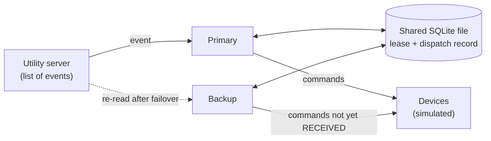

# vpp-dispatch-reliability

[](https://github.com/Vanneka/vpp-dispatch-reliability/actions/workflows/test.yml)

Open-source reference code for keeping a **virtual power plant (VPP)** dispatch correct when the platform's own servers fail.

**The question:** when a VPP platform's server fails partway through a dispatch, how does the backup finish the job without skipping or doubling a command?

> **Status:** v0.2.0, pre-release. Everything runs against a **simulated** fleet. No real-world performance is claimed.

## Why it matters

In a centralized design every dispatch decision runs through one software platform, which Idaho National Laboratory calls "a concentrated digital dependency for grid services" (INL, 2026, §7.2). Devices already have fallbacks when they lose contact (CSIP v2.1, §4.4.2). The platform needs its own.

## What v0.2.0 shows

- **The gap is real.** If the primary stops after sending a command but before recording it, the record says `PLANNED` while the device already has the command.
- **The backup closes it.** After a failover it sends again every command not yet `RECEIVED`, and leaves confirmed ones alone. Each device ends up with the planned command.
- **Sending twice is safe by design.** A command keeps the same ID (`mrid:deviceId`) and carries an absolute value for an absolute time window, so a second copy says exactly what the first said.
- **Missed events are picked up.** An event issued while no server was in charge is found on the utility's list and dispatched.
- **CSIP's 15-minute limit is met.** After a simulated crash and failover, every command is sent 11 s after the event arrived (simulated time).

## How it works



- **A lease decides who is in charge.** The primary renews it every few seconds. If it stops, the lease expires after 10 s and the backup takes it.
- **The whole plan is saved before anything is sent**, and each command's state only moves forward: `PLANNED` → `SENT` → `RECEIVED`.
- **Real platforms get leader election from their infrastructure** (for example, [Kubernetes Leases](https://kubernetes.io/docs/concepts/architecture/leases/)). What it doesn't decide is what to do with a half-finished dispatch. That is what this project shows.

## Run it

```bash
git clone https://github.com/Vanneka/vpp-dispatch-reliability.git
cd vpp-dispatch-reliability
./gradlew test   # 30 tests
./gradlew run    # a dispatch with a failover, saved to data/demo.db
```

You need Java 21. Setup, demo output and troubleshooting: [Getting started](docs/getting-started.md).

## How this maps to CSIP

| Here | In CSIP / IEEE 2030.5 |
|---|---|
| The platform | The aggregator, in the aggregator-mediated setup (§3.2) |
| `DispatchRequest` | A DERControl event: `mRID`, `creationTime`, start and duration (Figure 12) |
| `SimulatedUtilityServer` | The DERControlList the aggregator can fetch (§6.2.4) |
| `DeviceCommand` | Internal: aggregator-to-device is "outside the scope of CSIP" (§6.2.4) |
| `CSIP_TRANSFER_LIMIT` | "within 15 minutes of receiving the control from the server" (§4.5) |

## Roadmap

- [x] **v0.1.0:** simulated fleet; every step of a dispatch saved as it happens
- [x] **v0.2.0:** primary and backup with a lease; recovery after a failover; 15-minute transfer limit
- [ ] **v0.3.0:** rejecting outdated or superseded commands; replacement commands
- [ ] **v0.4.0:** retries, with each device response counted once
- [ ] **v1.0.0:** fault-injection test harness and a full write-up

What changed in each release: [CHANGELOG](CHANGELOG.md). Design decisions: [design notes](docs/design.md).

## Limitations

- Devices, the network and time are simulated; sending takes no time.
- Recovery handles the start of an event only.
- Replacement commands, retries and a paused primary are not handled yet.

Details and planned fixes: [design notes](docs/design.md#not-covered-yet).

## Read more

Blog series on the software behind VPPs: [post 3](https://vanneka-okeke.medium.com/the-brain-of-a-virtual-power-plant-why-its-reliability-matters-7c3855f928ed), [post 4](https://vanneka-okeke.medium.com/failover-isnt-enough-the-half-finished-dispatch-b7815acd1148).

## Sources

- M. Culler et al., *Virtual Power Plant Architecture and Resilient Design*, INL/RPT-26-89692, Idaho National Laboratory, 2026. https://inl.gov/content/uploads/2026/01/VPP-Architecture-and-Design-Report__Final.pdf
- *Common Smart Inverter Profile: IEEE 2030.5 Implementation Guide for Smart Inverters*, v2.1, 2018. https://sunspec.org/wp-content/uploads/2025/01/CSIPImplementationGuidev2.103-15-2018.pdf
- G. Zhang, C. Jiang, X. Wang, "Comprehensive review on structure and operation of virtual power plant in electrical system," *IET GTD* 13(2), 2019. https://doi.org/10.1049/iet-gtd.2018.5880

## License

Apache-2.0. See [LICENSE](LICENSE).
