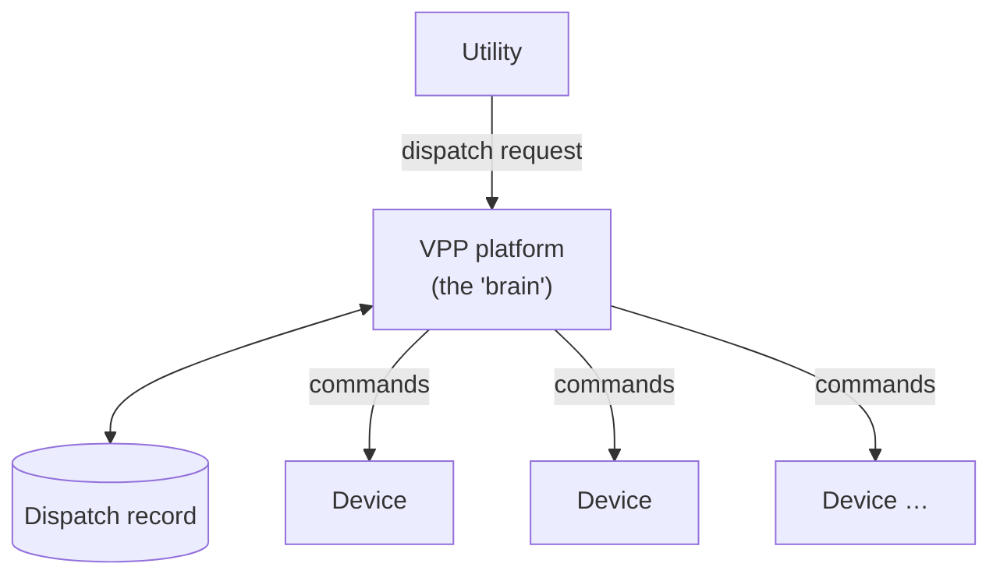

# Design notes

Why the code works the way it does. Back to the [README](../README.md).

## The problem



Devices can cover for each other: if one battery is unavailable, another can be asked. Nothing covers for the platform. If its server restarts mid-dispatch, whatever replaces it must know which devices were told what, and which confirmed.

## Command states

| State | Meaning | Release |
|---|---|---|
| `PLANNED` | Saved in the plan, not sent yet | v0.1.0 |
| `SENT` | Sent to the device's control unit; no confirmation yet | v0.1.0 |
| `RECEIVED` | The control unit confirmed the device has the command (delivery, not completion) | v0.2.0 (was `RESPONDED`) |
| `CANCELLED`, `SUPERSEDED` | The utility withdrew or replaced the event | planned, v0.3.0 |
| `STARTED`, `COMPLETED` | The device began or finished the event | planned, v0.4.0 |

States are internal to the platform, named after CSIP's event stages (v2.1, §4.4.1). They are not IEEE 2030.5 status codes.

## Decisions

**Save the whole plan first.** The dispatch and all its commands are written in one transaction, before anything is sent. A backup never sees half a plan.

**States only move forward.** The rule is inside the SQL `UPDATE` (`… WHERE state IN (earlier states)`), so it holds even with two servers writing to one file. A late "sent" can't erase a "received." A confirmation for a `PLANNED` command moves it straight to `RECEIVED`.

**Events are identified by the utility's mRID.** Requests are modeled on the DERControl event (CSIP v2.1, Figure 12). A command's ID is `mrid:deviceId`, never taken from the platform's clock, so every server reading the same event gets the same IDs. The same event delivered twice is not planned again; two different events with the same time and value are both dispatched.

**Commands are safe to send twice.** Each carries an absolute value ("hold 5 kW") for an absolute window ("17:00–19:00"), never "add 2 kW" or "in 5 minutes." A second copy says exactly what the first said. How a real device treats a repeat is up to its manufacturer: CSIP leaves the aggregator-to-device path "outside the scope of CSIP" (§6.2.4).

**A lease decides who is in charge.** One row in the shared SQLite file: holder and expiry time. The primary renews it every few seconds; if it stops, the lease expires after 10 s and the backup can take it. Each check-and-update is one SQL statement, so two servers can't both win. The lease sits behind a `LeaderElection` interface, where a real deployment would plug in its own infrastructure (Kubernetes uses Lease objects for "component-level leader election"). The coordinator checks the lease before planning and before every send.

**Time is injected.** Lease expiry and saved times come from a `java.time.Clock`, so tests move time forward without waiting.

## Recovery after a failover

After a failover, the backup calls `recoverAfterFailover`. It compares two things:

- **The utility's list of events:** what the utility asked for. The backup can always fetch this again.
- **The saved record:** which device was sent which command, and which confirmed. This is kept only by the platform, so if it is lost, nobody can rebuild it.

For each event on the utility's list:

- **Not in the record:** no server planned it (for example, it was issued while no server was in charge). Dispatch it now.
- **In the record:** send again every command not yet `RECEIVED`, in plan order. The record can't tell "never sent" from "sent just before the crash," so both are sent. The plan is not changed.

### Why this closes the v0.1.0 gap

The coordinator sends, then records. If it stops in between, the record says `PLANNED` for a command the device already has. Recording first has the opposite problem. v0.2.0 keeps the order and makes the gap harmless: the backup resends, and because the command is safe to send twice, each device ends up with one effective command.

## The 15-minute transfer limit

CSIP: an aggregator "SHALL transfer the DER control to the DERs within 15 minutes of receiving the control from the server" (v2.1, §4.5). A failover uses up part of that time.

- The record saves when each event was received and when each command was last sent.
- `timeToSendAll` reports how long it took until every command was sent; `sentWithin` checks it against a limit (`CSIP_TRANSFER_LIMIT`, or any other).
- Tests: the limit is met after a crash and failover (11 s); a late backup, a shorter limit and a command never sent are reported as missed.

This is simulated time, where sending takes none. For an event found only during recovery, "received" means when recovery found it, which is later than when the utility sent it.

## Not covered yet

- **Replacement commands** (moving a slow device's share to others) need the original marked as replaced, or recovery would resend it too. That needs `SUPERSEDED`: v0.3.0.
- **Ending an event:** recovery handles the start of an event only. It doesn't end an event early or skip one that's already over.
- **Responses that never arrive:** the command is resent on every recovery and stays `SENT`. Retries with a limit: v0.4.0.
- **A paused primary** can wake after its lease expired and send one command. A leadership number that rises with each failover will reject it: v0.3.0.

## What is simulated

- **Devices** hold the last command they receive and reply. No battery physics or timing.
- **Faults:** one, a lost response (the device still holds the command).
- **Servers:** primary and backup are two coordinators in one program, sharing one SQLite file. A crash is a test switch.
- **Time:** a clock the program controls. Sending takes no time.

## How the code is organized

```
src/main/java/io/github/vanneka/vppdispatch/
  Demo.java    the program behind ./gradlew run
  protocol/    dispatch requests (modeled on DERControl), device commands, responses
  fleet/       simulated devices, with injectable faults
  storage/     the dispatch record (SQLite)
  platform/    device selection and the dispatch coordinator
  failover/    the lease and the simulated crash
  utility/     a stand-in for the utility's server and its list of events
src/test/java/   scenario tests
```

The device selector is deliberately simple (largest devices first). Real platforms weigh device state, forecasts and customer settings (Zhang et al., 2019, §2.2).

## Sources

- INL (2026), §7.2: centralized control systems "form the operational 'brain' of a VPP and represent a concentrated digital dependency for grid services."
- CSIP v2.1 (2018): §4.4.2 (devices complete scheduled events on loss of communications), §4.5 (15-minute transfer), §6.2.4 (aggregator fetches the DERControlList; aggregator-to-device is out of scope).
- Kubernetes documentation, "Leases." https://kubernetes.io/docs/concepts/architecture/leases/
- Zhang, Jiang & Wang (2019), §2.2: static and dynamic DER parameters used to choose devices.

Full citations: [README](../README.md#sources).
